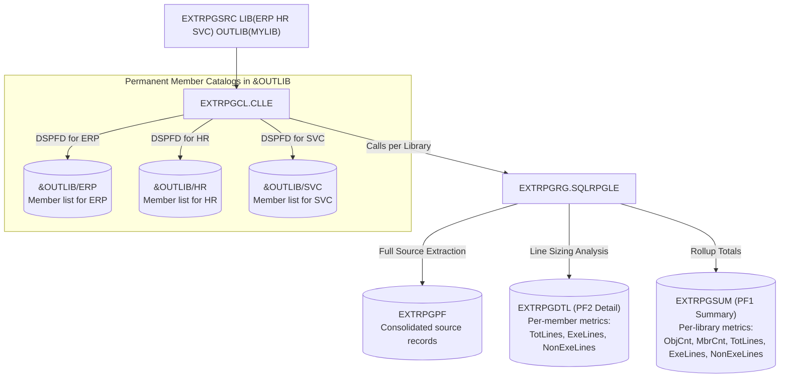

# IBM i (AS/400) RPG Source Extraction & Sizing Analyzer (`EXTRPGSRC`)

## Overview

The `EXTRPGSRC` utility extracts source code from all eligible RPG-related source members across 1 to 10 specified libraries, consolidates the extracted source records into `EXTRPGPF`, stores each library's member catalog permanently in `&OUTLIB` named after the library (e.g. `&OUTLIB/ERP`, `&OUTLIB/HR`), and performs **automated source code sizing** (counting executable vs. non-executable lines) into **two dedicated physical files (PF1 and PF2)**.

---

## Output Tables Architecture in `&OUTLIB`



---

## Output Physical Files Specifications

### 1. Library Member Catalogs: `&OUTLIB/&CURLIB`
Generated via `DSPFD FILE(&CURLIB/*ALL) TYPE(*MBRLIST) OUTPUT(*OUTFILE) OUTFILE(&OUTLIB/&CURLIB)`.  
Each specified library gets its own dedicated permanent member catalog file in `&OUTLIB`:
- E.g. If you process `ERP`, the table created is `&OUTLIB/ERP`.
- If you process `HR`, the table created is `&OUTLIB/HR`.
- If you process `SVC`, the table created is `&OUTLIB/SVC`.

### 2. `EXTRPGSUM`: PF1 (Library Summary Level)
Stores **one row per library** with high-level sizing metrics:

| Column Name | Type | Description |
| :--- | :--- | :--- |
| `LIBNAME` | CHAR(10) | Library name |
| `OBJCNT` | NUMERIC(10, 0) | Distinct source physical files (objects) processed |
| `MBRCNT` | NUMERIC(10, 0) | Eligible RPG source members processed |
| `TOTLINES` | NUMERIC(10, 0) | Total source lines in the library |
| `EXELINES` | NUMERIC(10, 0) | Total executable lines (C-specs / free-form operations) |
| `NONEXELIN`| NUMERIC(10, 0) | Total non-executable lines (comments, blanks, H/F/D/I/O specs) |

### 3. `EXTRPGDTL`: PF2 (Member Detail Level)
Stores **one row per member** with detailed sizing metrics:

| Column Name | Type | Description |
| :--- | :--- | :--- |
| `SRCLIB` | CHAR(10) | Source library name |
| `SRCFILE` | CHAR(10) | Source physical file name |
| `SRCMBR` | CHAR(10) | Member name |
| `SRCTYPE` | CHAR(10) | Source type (`RPGLE`, `SQLRPGLE`, `RPG`, etc.) |
| `TOTLINES` | NUMERIC(10, 0) | Total source lines in this member |
| `EXELINES` | NUMERIC(10, 0) | Executable lines in this member |
| `NONEXELIN`| NUMERIC(10, 0) | Non-executable lines in this member |

### 4. `EXTRPGPF`: Consolidated Source Records Repository
Contains the full text and metadata of every source line extracted:
* `SRCLIB`, `SRCFILE`, `SRCMBR`, `SRCTYPE`, `SRCSEQ`, `SRCDAT`, `SRCDTA` (256A).

---

## Line Sizing Rules (Executable vs. Non-Executable)

Every line in an eligible member is classified deterministically:

$$\text{TOTLINES} = \text{EXELINES} + \text{NONEXELIN}$$

### 1. Executable Lines (`EXELINES`)
Lines containing business logic / executable instructions:
* **Fixed-form RPG**: Calculation specifications (**C-specs**, where Column 6 = `'C'`) that are **not** comments.
* **Free-form RPG**: Operational statements: calculations, assignments (`x = y + 1;`), `eval`, `if`, `select`, `when`, `for`, `dow`, `dou`, `exec sql`, `chain`, `read`, `callp`, `return`.

### 2. Non-Executable Lines (`NONEXELIN`)
Lines containing no runtime operations:
* **Blank lines**: Completely empty lines.
* **Comments**:
  * Fixed-form: Column 7 has an asterisk (`*`).
  * Free-form: Lines starting with `//` or block comments.
* **Compiler directives**: Lines starting with `/` (`/copy`, `/include`, `/free`, `/endif`).
* **Declarative specifications**:
  * Fixed-form: `H` (Header), `F` (File), `D` (Data definition), `I` (Input), `O` (Output).
  * Free-form: `ctl-opt`, `dcl-f`, `dcl-s`, `dcl-ds`, `dcl-pr`, `dcl-pi`, `end-ds`, etc.

---

## Compilation Sequence

Compile into your target library (e.g. `MYLIB`):

```cl
/* Using automated build script */
CRTBNDCL PGM(MYLIB/BUILD) SRCFILE(MYLIB/QCLLESRC) SRCMBR(BUILD) DBGVIEW(*SOURCE)
CALL PGM(MYLIB/BUILD) PARM('MYLIB')
```

Or manually:
```cl
/* 1. Source Records PF */
CRTPF FILE(MYLIB/EXTRPGPF) SRCFILE(MYLIB/QDDSSRC) SRCMBR(EXTRPGPF)

/* 2. PF1: Summary Metrics */
CRTPF FILE(MYLIB/EXTRPGSUM) SRCFILE(MYLIB/QDDSSRC) SRCMBR(EXTRPGSUM)

/* 3. PF2: Detail Metrics */
CRTPF FILE(MYLIB/EXTRPGDTL) SRCFILE(MYLIB/QDDSSRC) SRCMBR(EXTRPGDTL)

/* 4. RPGLE Engine */
CRTSQLRPGI OBJ(MYLIB/EXTRPGRG) SRCFILE(MYLIB/QRPGLESRC) SRCMBR(EXTRPGRG) +
           OBJTYPE(*PGM) COMMIT(*NONE) REPLACE(*YES) DBGVIEW(*SOURCE)

/* 5. Validity Checking Program */
CRTBNDCL PGM(MYLIB/CHKLIBS) SRCFILE(MYLIB/QCLLESRC) SRCMBR(CHKLIBS) +
         REPLACE(*YES) DBGVIEW(*SOURCE)

/* 6. Command Processing Program */
CRTBNDCL PGM(MYLIB/EXTRPGCL) SRCFILE(MYLIB/QCLLESRC) SRCMBR(EXTRPGCL) +
         REPLACE(*YES) DBGVIEW(*SOURCE)

/* 7. Custom Command */
CRTCMD CMD(MYLIB/EXTRPGSRC) PGM(MYLIB/EXTRPGCL) SRCFILE(MYLIB/QCMDSRC) +
       SRCMBR(EXTRPGSRC) VLDPGM(MYLIB/CHKLIBS) REPLACE(*YES) +
       TEXT('Extract RPG Source & Metrics to Consolidated PFs')
```

---

## Verification SQL Queries

Run these queries to inspect your extraction and metrics:

### Query PF1: Library Summary
```sql
SELECT LIBNAME, OBJCNT, MBRCNT, TOTLINES, EXELINES, NONEXELIN
FROM MYLIB.EXTRPGSUM;
```

### Query PF2: Member Detail
```sql
SELECT SRCLIB, SRCFILE, SRCMBR, SRCTYPE, TOTLINES, EXELINES, NONEXELIN
FROM MYLIB.EXTRPGDTL
ORDER BY SRCLIB, SRCFILE, SRCMBR;
```

### Query Member Catalog for Library `ERP`
```sql
SELECT MLLIB, MLFILE, MLNAME, MLSEU2, MLFTYP
FROM MYLIB.ERP
WHERE MLFTYP = 'S';
```
