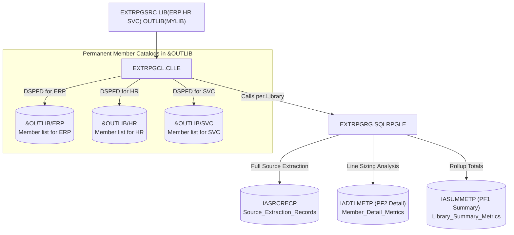

# IBM i (AS/400) RPG Source Extraction & Sizing Analyzer (`EXTRPGSRC`)

## Overview

The `EXTRPGSRC` utility extracts source code from all eligible RPG-related source members across 1 to 10 specified libraries, consolidates the extracted source records into `IASRCRECP`, stores each library's member catalog permanently in `&OUTLIB` named after the library (e.g. `&OUTLIB/ERP`, `&OUTLIB/HR`), and performs **automated source code sizing** (counting executable vs. non-executable lines) into **two dedicated DDL physical files (PF1: `IASUMMETP` and PF2: `IADTLMETP`)**.

---

## Coding Standards & Architectural Guidelines Adherence

The codebase strictly adheres to the enterprise IBM i / Programmers.io coding guidelines:

1. **Database Tables (DDL Members)**:
   - Created via SQL DDL (`RUNSQLSTM`).
   - Use descriptive long names:
     - `Create Or Replace Table Library_Summary_Metrics`
     - `Create Or Replace Table Member_Detail_Metrics`
     - `Create Or Replace Table Source_Extraction_Records`
   - Renamed to standardized short system names starting with `IA` and ending with `P`:
     - `IASUMMETP` (PF1: Summary)
     - `IADTLMETP` (PF2: Detail)
     - `IASRCRECP` (Source Records)
   - Field names start with `IA` and use `FOR COLUMN`:
     - E.g. `Library_Name FOR COLUMN IALIBNAM`, `Executable_Lines FOR COLUMN IAEXELIN`.
2. **RPGLE Naming & Grouping**:
   - Header with **Procedure Log** and **Modification Log**.
   - `ctl-opt copyright('Programmers.io @ 2022')`.
   - **Work variables** start with `uw`, in camelCase without underscores, grouped by type (Character/Varchar -> Indicator -> Packed/Numeric), and initialized with `inz`.
   - **Parameters** start with `up` (e.g. `upLib`, `upOutLib`, `upStatus`).
   - **Data structures** start with `ud` and subfields with `us` (`udMbrDtl` with `usFile`, `usName`, `usType`).
   - **Arrays** start with `ur` and indices with `ui` (`urEligTypes`, `uiEligType`).
   - **Procedures** use verb/object syntax (`chkEligibleType`, `chkExecutableLine`).
   - **No right-hand end-line comments**: all comments placed above code lines.
   - **SELECT/WHEN/OTHER/ENDSL** used instead of nested IF/ELSE/ENDIF.

---

## Output Tables Architecture in `&OUTLIB`



---

## Output Physical Files Specifications

### 1. Library Member Catalogs: `&OUTLIB/&CURLIB`
Generated via `DSPFD FILE(&CURLIB/*ALL) TYPE(*MBRLIST) OUTPUT(*OUTFILE) OUTFILE(&OUTLIB/&CURLIB)`.  
Each specified library gets its own dedicated permanent member catalog file in `&OUTLIB`:
- E.g. If you process `ERP`, the table created is `&OUTLIB/ERP`.
- If you process `HR`, the table created is `&OUTLIB/HR`.
- If you process `SVC`, the table created is `&OUTLIB/SVC`.

### 2. `IASUMMETP`: PF1 (Library Summary Level)
*Table: `Library_Summary_Metrics`*

| Long Column Name | Short Column Name | Type | Description |
| :--- | :--- | :--- | :--- |
| `Library_Name` | `IALIBNAM` | CHAR(10) | Library name |
| `Object_Count` | `IAOBJCNT` | NUMERIC(10, 0) | Distinct source physical files (objects) processed |
| `Member_Count` | `IAMBRCNT` | NUMERIC(10, 0) | Eligible RPG source members processed |
| `Total_Lines` | `IATOTLIN` | NUMERIC(10, 0) | Total source lines in the library |
| `Executable_Lines` | `IAEXELIN` | NUMERIC(10, 0) | Total executable lines (C-specs / free-form operations) |
| `Non_Executable_Lines`| `IANOEXEL` | NUMERIC(10, 0) | Total non-executable lines (comments, blanks, H/F/D/I/O specs)|

### 3. `IADTLMETP`: PF2 (Member Detail Level)
*Table: `Member_Detail_Metrics`*

| Long Column Name | Short Column Name | Type | Description |
| :--- | :--- | :--- | :--- |
| `Source_Library` | `IASRCLIB` | CHAR(10) | Source library name |
| `Source_File` | `IASRCFIL` | CHAR(10) | Source physical file name |
| `Member_Name` | `IASRCMBR` | CHAR(10) | Member name |
| `Member_Type` | `IASRCTYP` | CHAR(10) | Source type (`RPGLE`, `SQLRPGLE`, `RPG`, etc.) |
| `Total_Lines` | `IATOTLIN` | NUMERIC(10, 0) | Total source lines in this member |
| `Executable_Lines` | `IAEXELIN` | NUMERIC(10, 0) | Executable lines in this member |
| `Non_Executable_Lines`| `IANOEXEL` | NUMERIC(10, 0) | Non-executable lines in this member |

### 4. `IASRCRECP`: Consolidated Source Records Repository
*Table: `Source_Extraction_Records`*

| Long Column Name | Short Column Name | Type | Description |
| :--- | :--- | :--- | :--- |
| `Source_Library` | `IASRCLIB` | CHAR(10) | Origin library name |
| `Source_File` | `IASRCFIL` | CHAR(10) | Origin source file name |
| `Member_Name` | `IASRCMBR` | CHAR(10) | Origin member name |
| `Member_Type` | `IASRCTYP` | CHAR(10) | Member source type |
| `Source_Sequence`| `IASRCSEQ` | DECIMAL(6, 2) | Sequence number |
| `Source_Date` | `IASRCDAT` | NUMERIC(6, 0) | Modification date |
| `Source_Data` | `IASRCDTA` | VARCHAR(256) | Actual source code line text |

---

## Line Sizing Rules (Executable vs. Non-Executable)

Every line in an eligible member is classified deterministically:

$$\text{IATOTLIN} = \text{IAEXELIN} + \text{IANOEXEL}$$

### 1. Executable Lines (`IAEXELIN`)
Lines containing business logic / executable instructions:
* **Fixed-form RPG**: Calculation specifications (**C-specs**, where Column 6 = `'C'`) that are **not** comments.
* **Free-form RPG**: Operational statements: calculations, assignments (`x = y + 1;`), `eval`, `if`, `select`, `when`, `for`, `dow`, `dou`, `exec sql`, `chain`, `read`, `callp`, `return`.

### 2. Non-Executable Lines (`IANOEXEL`)
Lines containing no runtime operations:
* **Blank lines**: Completely empty lines.
* **Comments**:
  * Fixed-form: Column 7 has an asterisk (`*`).
  * Free-form: Lines starting with `//` or block comments.
* **Compiler directives**: Lines starting with `/` (`/copy`, `/include`, `/free`, `/endif`).
* **Declarative specifications**:
  * Fixed-form: `H` (Header), `F` (File), `D` (Data definition), `I` (Input), `O` (Output).
  * Free-form: `ctl-opt`, `dcl-f`, `dcl-s`, `dcl-ds`, `dcl-pr`, `dcl-pi`, `end-ds`, etc.

---

## Compilation Sequence

Compile into your target library (e.g. `MYLIB`):

```cl
/* Using automated build script */
CRTBNDCL PGM(MYLIB/BUILD) SRCFILE(MYLIB/QCLLESRC) SRCMBR(BUILD) DBGVIEW(*SOURCE)
CALL PGM(MYLIB/BUILD) PARM('MYLIB')
```

Or manually:
```cl
/* 1. DDL: Source Records Table */
RUNSQLSTM SRCFILE(MYLIB/QSQLSRC) SRCMBR(IASRCRECP) COMMIT(*NONE) DFTRDBCOL(MYLIB)

/* 2. DDL: PF1 Summary Metrics Table */
RUNSQLSTM SRCFILE(MYLIB/QSQLSRC) SRCMBR(IASUMMETP) COMMIT(*NONE) DFTRDBCOL(MYLIB)

/* 3. DDL: PF2 Detail Metrics Table */
RUNSQLSTM SRCFILE(MYLIB/QSQLSRC) SRCMBR(IADTLMETP) COMMIT(*NONE) DFTRDBCOL(MYLIB)

/* 4. RPGLE Engine */
CRTSQLRPGI OBJ(MYLIB/EXTRPGRG) SRCFILE(MYLIB/QRPGLESRC) SRCMBR(EXTRPGRG) +
           OBJTYPE(*PGM) COMMIT(*NONE) REPLACE(*YES) DBGVIEW(*SOURCE)

/* 5. Validity Checking Program */
CRTBNDCL PGM(MYLIB/CHKLIBS) SRCFILE(MYLIB/QCLLESRC) SRCMBR(CHKLIBS) +
         REPLACE(*YES) DBGVIEW(*SOURCE)

/* 6. Command Processing Program */
CRTBNDCL PGM(MYLIB/EXTRPGCL) SRCFILE(MYLIB/QCLLESRC) SRCMBR(EXTRPGCL) +
         REPLACE(*YES) DBGVIEW(*SOURCE)

/* 7. Custom Command */
CRTCMD CMD(MYLIB/EXTRPGSRC) PGM(MYLIB/EXTRPGCL) SRCFILE(MYLIB/QCMDSRC) +
       SRCMBR(EXTRPGSRC) VLDPGM(MYLIB/CHKLIBS) REPLACE(*YES) +
       TEXT('Extract RPG Source & Metrics to Consolidated PFs')
```

---

## Verification SQL Queries

Run these queries to inspect your extraction and metrics:

### Query PF1: Library Summary (`IASUMMETP`)
```sql
SELECT IALIBNAM, IAOBJCNT, IAMBRCNT, IATOTLIN, IAEXELIN, IANOEXEL
FROM MYLIB.IASUMMETP;
```

### Query PF2: Member Detail (`IADTLMETP`)
```sql
SELECT IASRCLIB, IASRCFIL, IASRCMBR, IASRCTYP, IATOTLIN, IAEXELIN, IANOEXEL
FROM MYLIB.IADTLMETP
ORDER BY IASRCLIB, IASRCFIL, IASRCMBR;
```

### Query Member Catalog for Library `ERP`
```sql
SELECT MLLIB, MLFILE, MLNAME, MLSEU2, MLFTYP
FROM MYLIB.ERP
WHERE MLFTYP = 'S';
```
