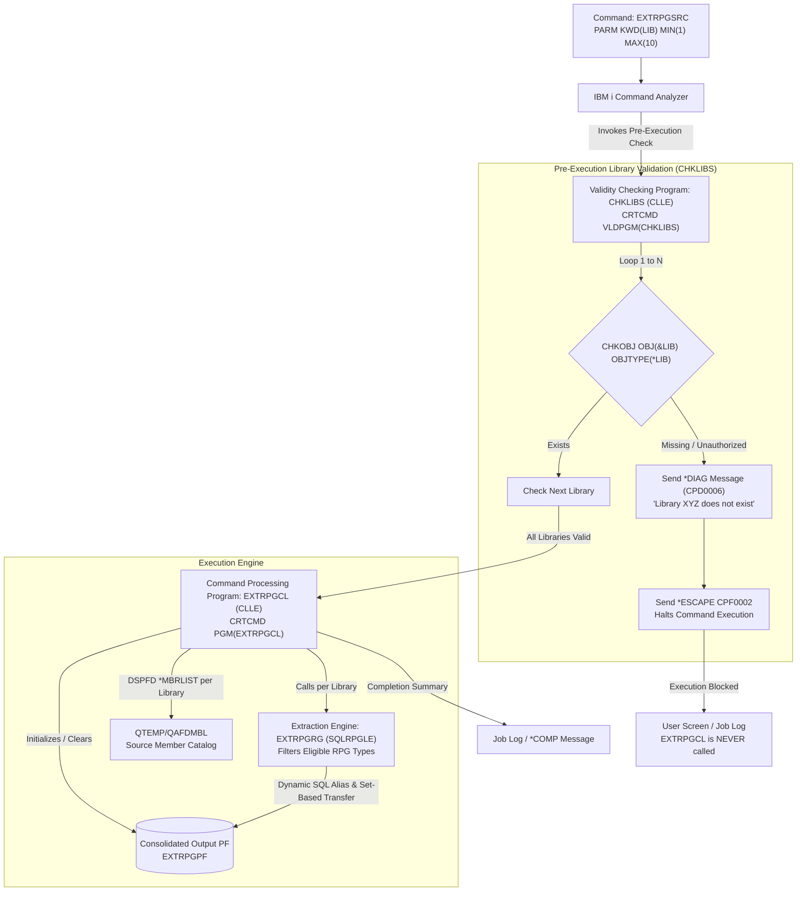

# IBM i (AS/400) RPG Source Extraction Utility (`EXTRPGSRC`)

## Overview

The `EXTRPGSRC` utility is a production-grade IBM i tool that extracts source code from all eligible RPG-related source members across 1 to 10 specified libraries, consolidating the extracted source records and rich metadata into a single Physical File (`EXTRPGPF`).

### Key Capabilities

1. **Pre-Execution Library Validation (`VLDPGM`)**: Uses a dedicated Validity Checking Program (`CHKLIBS`) on `CRTCMD` to verify that all specified libraries exist and are accessible before the Command Processing Program (`EXTRPGCL`) is ever invoked. If any library does not exist, the utility immediately halts with diagnostic message `CPD0006` ("Library XYZ does not exist") and escape message `CPF0002`.
2. **File-Name Independence**: Discovers source members using `DSPFD FILE(&LIB/*ALL) TYPE(*MBRLIST)`. It does not assume standard names like `QRPGLESRC` or `QRPGSRC`; it extracts from custom files like `APPSRCS`, `DEVSRC`, `MYPGMS`, etc.
3. **Source Type Filtering**: Identifies RPG source based strictly on member source type (`MLSEU2`):
   - `RPGLE` (ILE RPG - fixed and free-form `**FREE`)
   - `SQLRPGLE` (ILE RPG with embedded SQL)
   - `RPG` (RPG III / RPG 400)
   - `SQLRPG` (RPG III with embedded SQL)
   - `RPG38` (System/38 RPG)
   - `RPGP` (RPG Program)
   - Non-RPG types (e.g. `CLP`, `CLLE`, `DDS`, `TXT`, `CBL`) are safely skipped.
4. **Zero Record Format Level Checks (`CPF4131`)**: Avoids traditional `OVRDBF` level check errors and buffer truncations by using dynamic DB2 for i SQL member aliasing (`CREATE OR REPLACE ALIAS QTEMP.CURSRCMBR`) and set-based block transfer (`INSERT INTO ... SELECT ...`).
5. **Full Metadata Preservation**: Retains source sequence numbers (`SRCSEQ`), modification dates (`SRCDAT`), exact source text (`SRCDTA`), source member (`SRCMBR`), source file (`SRCFILE`), and origin library (`SRCLIB`).
6. **Execution Summary Report**: Issues completion message `*COMP` with counts of libraries processed, failures, eligible members found, and total source lines consolidated.

---

## Architecture Diagram



---

## Source Components & Object Structure

| Component | Source Member | Language / Type | Description |
| :--- | :--- | :--- | :--- |
| **Command** | `QCMDSRC/EXTRPGSRC.CMD` | `*CMD` | Custom command definition with `MIN(1) MAX(10)`. Binds `VLDPGM(CHKLIBS)` and `PGM(EXTRPGCL)`. |
| **Validity Program** | `QCLLESRC/CHKLIBS.CLLE` | `*PGM (CLLE)` | Pre-execution validator. Validates that all entered libraries exist. Emits `CPD0006` diagnostics and raises `CPF0002` if invalid. |
| **Controller Program** | `QCLLESRC/EXTRPGCL.CLLE` | `*PGM (CLLE)` | Main CPP coordinator. Clears output PF, loops through libraries, calls `DSPFD`, invokes RPGLE extractor, and emits completion summary. |
| **Extraction Engine** | `QRPGLESRC/EXTRPGRG.SQLRPGLE` | `*PGM (SQLRPGLE)`| Free-form RPGLE engine. Reads `QTEMP/QAFDMBL`, filters RPG types via `isEligibleType()`, creates dynamic SQL aliases, and inserts records into output PF. |
| **Consolidated PF (DDS)** | `QDDSSRC/EXTRPGPF.PF` | `*FILE (PF)` | DDS specification of the output consolidated physical file. |
| **Consolidated PF (SQL)** | `QSQLSRC/EXTRPGPF.SQL` | `*FILE (TABLE)` | Modern SQL DDL alternative script for creating `EXTRPGPF`. |
| **Build Script** | `BUILD.CLLE` | `*PGM (CLLE)` | Automated build script compiling all objects in exact dependency order. |

---

## Command Syntax & Parameters

### Syntax
```cl
EXTRPGSRC LIB(lib-name-1 [lib-name-2 ... lib-name-10])
          [OUTLIB(*CURLIB | library-name)]
          [OUTFILE(EXTRPGPF | file-name)]
          [CLEAR(*YES | *NO)]
```

### Parameters

#### 1. `LIB` (Libraries to extract)
- **Type**: `*NAME`
- **Length**: 10 characters each
- **Requirements**: `MIN(1)`, `MAX(10)`
- **Behavior**: Enforced directly by OS/400 Command Analyzer. Specifying 0 or >10 libraries is rejected immediately before any program executes.

#### 2. `OUTLIB` (Output library)
- **Type**: `*NAME`
- **Default**: `*CURLIB`
- **Behavior**: If `*CURLIB` is specified, resolves to the current job library. If no current library is active (`*NONE`), defaults to `QGPL`.

#### 3. `OUTFILE` (Output physical file)
- **Type**: `*NAME`
- **Default**: `EXTRPGPF`
- **Behavior**: Name of the consolidated physical file where source records will be written.

#### 4. `CLEAR` (Clear output file first)
- **Values**: `*YES` (default) or `*NO`
- **Behavior**: When `*YES`, executes `CLRPFM` on the output file before extraction starts. When `*NO`, new records are appended to existing data.

---

## Installation & Compilation Guide

### Step 1: Prepare Source Physical Files
Create standard source physical files in your build library (e.g., `MYLIB`):

```cl
CRTSRCPF FILE(MYLIB/QCMDSRC)   RCDLEN(112) TEXT('Command source')
CRTSRCPF FILE(MYLIB/QCLLESRC)  RCDLEN(112) TEXT('CLLE source')
CRTSRCPF FILE(MYLIB/QRPGLESRC) RCDLEN(112) TEXT('SQLRPGLE source')
CRTSRCPF FILE(MYLIB/QDDSSRC)   RCDLEN(112) TEXT('DDS source')
CRTSRCPF FILE(MYLIB/QSQLSRC)   RCDLEN(112) TEXT('SQL DDL source')
```

### Step 2: Upload Source Files to IBM i
Copy or FTP the repository files to the corresponding source physical file members:
- `QCMDSRC/EXTRPGSRC.CMD`   -> `MYLIB/QCMDSRC(EXTRPGSRC)`
- `QCLLESRC/CHKLIBS.CLLE`   -> `MYLIB/QCLLESRC(CHKLIBS)`
- `QCLLESRC/EXTRPGCL.CLLE`  -> `MYLIB/QCLLESRC(EXTRPGCL)`
- `QRPGLESRC/EXTRPGRG.SQLRPGLE` -> `MYLIB/QRPGLESRC(EXTRPGRG)`
- `QDDSSRC/EXTRPGPF.PF`     -> `MYLIB/QDDSSRC(EXTRPGPF)`
- `BUILD.CLLE`              -> `MYLIB/QCLLESRC(BUILD)`

### Step 3: Run the Automated Build Script
Compile `BUILD.CLLE` once and call it:

```cl
CRTBNDCL PGM(MYLIB/BUILD) SRCFILE(MYLIB/QCLLESRC) SRCMBR(BUILD) DBGVIEW(*SOURCE)
CALL PGM(MYLIB/BUILD) PARM('MYLIB')
```

Alternatively, compile each component manually in strict dependency order:

```cl
/* 1. Output Physical File */
CRTPF FILE(MYLIB/EXTRPGPF) SRCFILE(MYLIB/QDDSSRC) SRCMBR(EXTRPGPF)

/* 2. SQLRPGLE Extraction Engine */
CRTSQLRPGI OBJ(MYLIB/EXTRPGRG) SRCFILE(MYLIB/QRPGLESRC) SRCMBR(EXTRPGRG) +
           OBJTYPE(*PGM) COMMIT(*NONE) REPLACE(*YES) DBGVIEW(*SOURCE)

/* 3. Validity Checking Program */
CRTBNDCL PGM(MYLIB/CHKLIBS) SRCFILE(MYLIB/QCLLESRC) SRCMBR(CHKLIBS) +
         REPLACE(*YES) DBGVIEW(*SOURCE)

/* 4. Command Processing Program */
CRTBNDCL PGM(MYLIB/EXTRPGCL) SRCFILE(MYLIB/QCLLESRC) SRCMBR(EXTRPGCL) +
         REPLACE(*YES) DBGVIEW(*SOURCE)

/* 5. Custom Command */
CRTCMD CMD(MYLIB/EXTRPGSRC) PGM(MYLIB/EXTRPGCL) SRCFILE(MYLIB/QCMDSRC) +
       SRCMBR(EXTRPGSRC) VLDPGM(MYLIB/CHKLIBS) REPLACE(*YES) +
       TEXT('Extract RPG Source to Consolidated PF')
```

---

## Sample Command Invocations

### Example 1: Single Library Extraction
```cl
EXTRPGSRC LIB(DEVLIB)
```

### Example 2: Multiple Libraries with Custom Output
```cl
EXTRPGSRC LIB(ERP HR SVC) OUTLIB(PRODLIB) OUTFILE(RPGREPO) CLEAR(*YES)
```

### Example 3: Ten Libraries Extraction (Maximum Limit)
```cl
EXTRPGSRC LIB(LIB01 LIB02 LIB03 LIB04 LIB05 LIB06 LIB07 LIB08 LIB09 LIB10)
```

### Example 4: Append Mode (`CLEAR(*NO)`)
```cl
EXTRPGSRC LIB(NEWMODLIB) CLEAR(*NO)
```

---

## Comprehensive Test Plan & Verification

| Test ID | Test Scenario | Invocation | Expected Result |
| :--- | :--- | :--- | :--- |
| **TC-01** | Single invalid library | `EXTRPGSRC LIB(BADLIB)` | `CHKLIBS` detects missing library, sends diagnostic `CPD0006` "Library BADLIB does not exist", halts with `CPF0002`. `EXTRPGCL` is **never** invoked. |
| **TC-02** | Mixed valid & invalid libraries | `EXTRPGSRC LIB(DEVLIB FAKELIB1 FAKELIB2)` | `CHKLIBS` reports diagnostics for both `FAKELIB1` and `FAKELIB2`. Halts execution. Zero files modified. |
| **TC-03** | Unauthorized library | User without `*USE` authority | `CHKLIBS` traps `CPF9802`. Diagnostic: "Not authorized to library ...". Execution halted. |
| **TC-04** | Single valid library | `EXTRPGSRC LIB(DEVLIB)` | `CHKLIBS` passes. `EXTRPGCL` extracts all RPG/RPGLE/SQLRPGLE members into `EXTRPGPF`. Completion message returned. |
| **TC-05** | Multiple valid libraries | `EXTRPGSRC LIB(ERP HR SVC)` | All 3 libraries processed. Records tagged with `SRCLIB = 'ERP'`, `'HR'`, and `'SVC'`. |
| **TC-06** | Maximum (10) libraries | 10 valid libraries | All 10 validated and processed. Summary reports 10 libraries processed. |
| **TC-07** | Exceed limit (>10 libraries) | 11 libraries in command line | OS/400 Command Analyzer immediately rejects with `CPD0014` / `CPF0001` before `CHKLIBS` is called. |
| **TC-08** | Non-standard source file names | Member in `CUSTOMSRC` file of type `RPGLE` | Discovered by `DSPFD` where `MLFTYP='S'` and `MLSEU2='RPGLE'`. Extracted without level check error. |
| **TC-09** | Diverse source types | Source file with `RPG`, `RPGLE`, `SQLRPGLE`, `CLLE`, `DDS` | `RPG`, `RPGLE`, `SQLRPGLE` extracted; non-RPG types (`CLLE`, `DDS`) ignored. |
| **TC-10** | Empty member | Source member with 0 lines | Handled smoothly by `INSERT ... SELECT`; 0 rows inserted; member counted; process continues. |
| **TC-11** | Output Clear vs Append | `CLEAR(*NO)` | Prior records preserved; new records appended. |

---

## Output Verification SQL Queries

Run these queries in **ACS Run SQL Scripts**, **STRSQL**, or via CLI to inspect the consolidated output:

```sql
-- 1. Summary by Library, Source File, and Source Type
SELECT 
    SRCLIB, 
    SRCFILE, 
    SRCTYPE, 
    COUNT(DISTINCT SRCMBR) AS TOTAL_MEMBERS, 
    COUNT(*) AS TOTAL_SOURCE_LINES
FROM QGPL.EXTRPGPF
GROUP BY SRCLIB, SRCFILE, SRCTYPE
ORDER BY SRCLIB, SRCFILE, SRCTYPE;

-- 2. Inspect source records of a specific extracted member
SELECT SRCSEQ, SRCDAT, SRCDTA
FROM QGPL.EXTRPGPF
WHERE SRCLIB = 'ERP' AND SRCMBR = 'ORD010R'
ORDER BY SRCSEQ;

-- 3. Confirm that no non-RPG types were extracted
SELECT DISTINCT SRCTYPE
FROM QGPL.EXTRPGPF;

-- 4. Check total lines extracted and audit timestamp
SELECT 
    COUNT(*) AS TOTAL_LINES,
    COUNT(DISTINCT SRCLIB) AS TOTAL_LIBRARIES,
    COUNT(DISTINCT SRCMBR) AS TOTAL_MEMBERS
FROM QGPL.EXTRPGPF;
```
